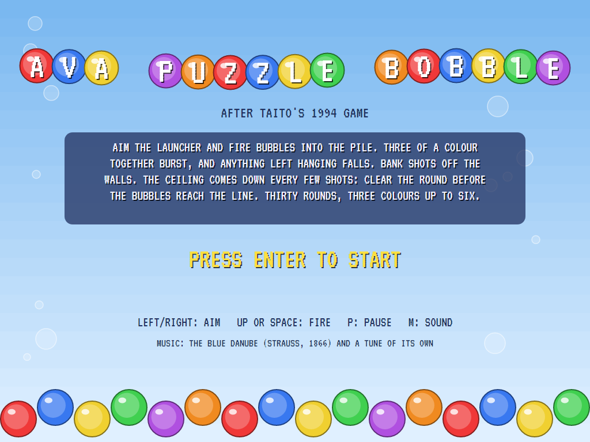
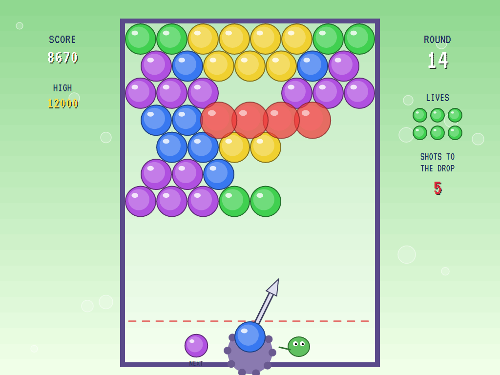
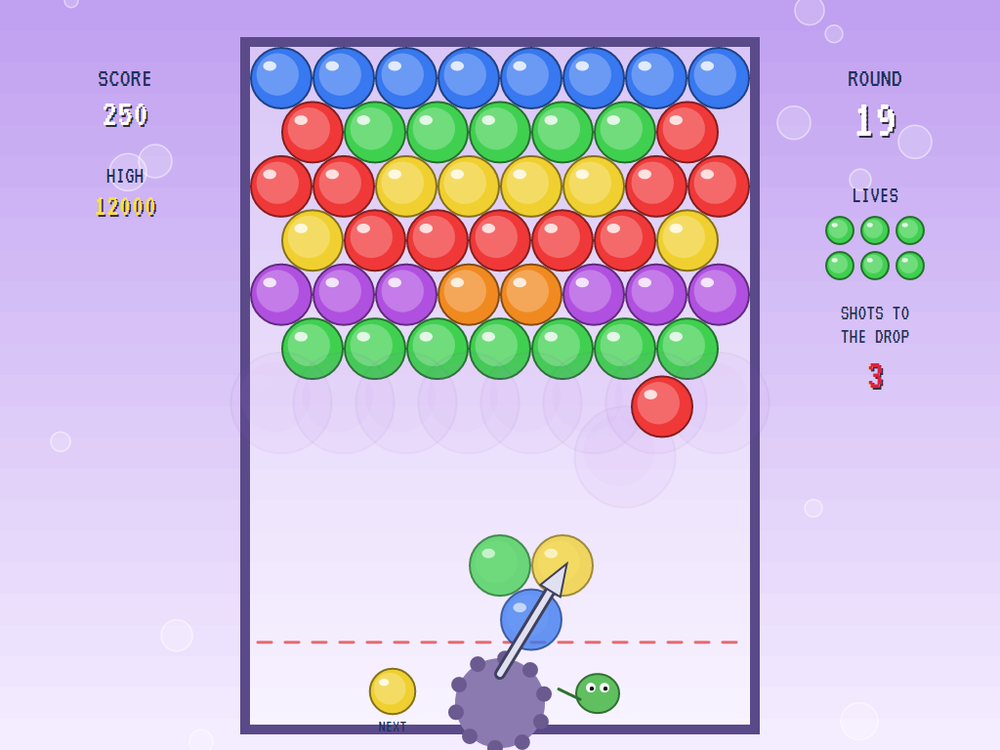
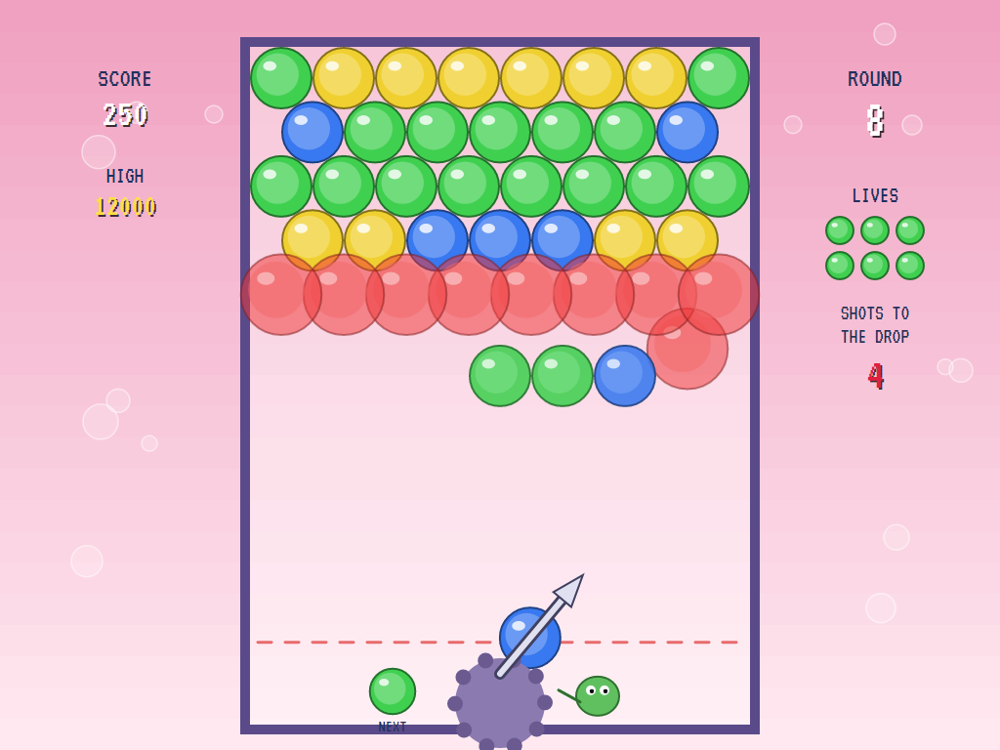
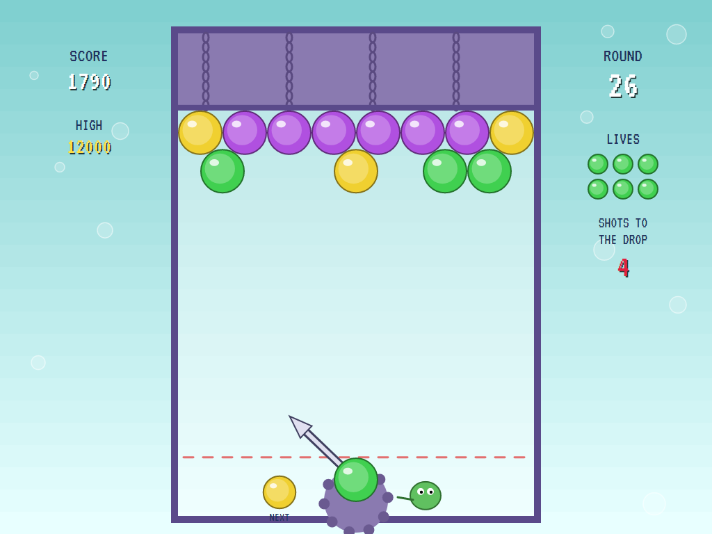
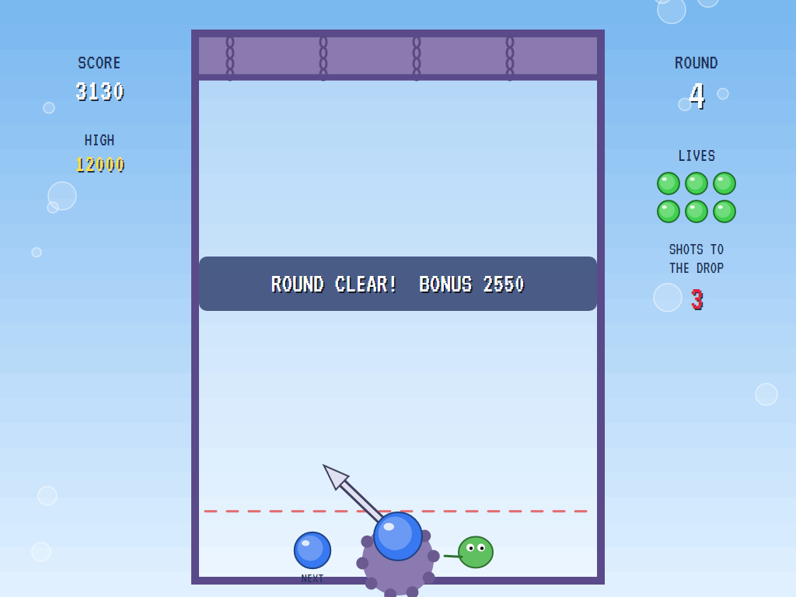
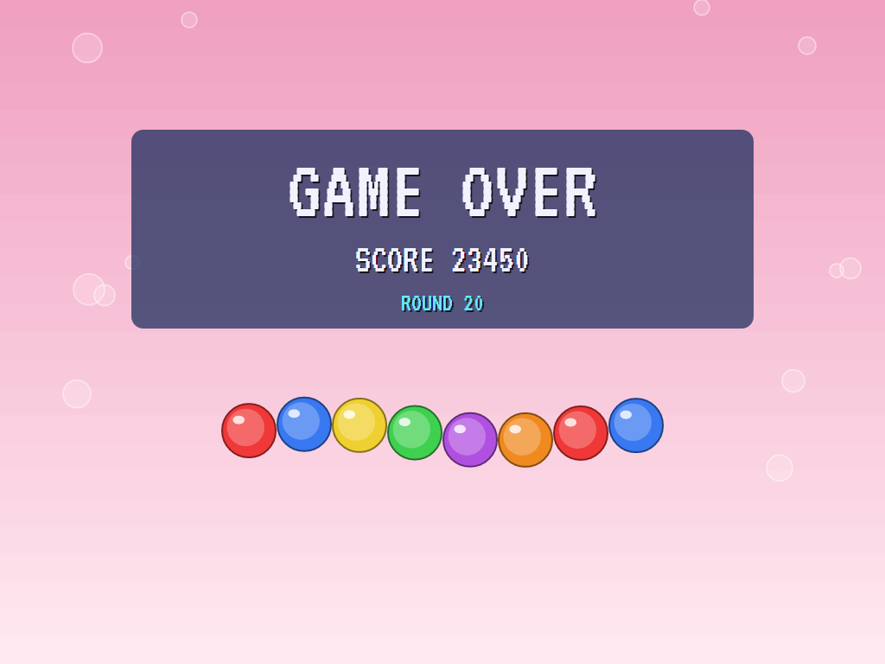
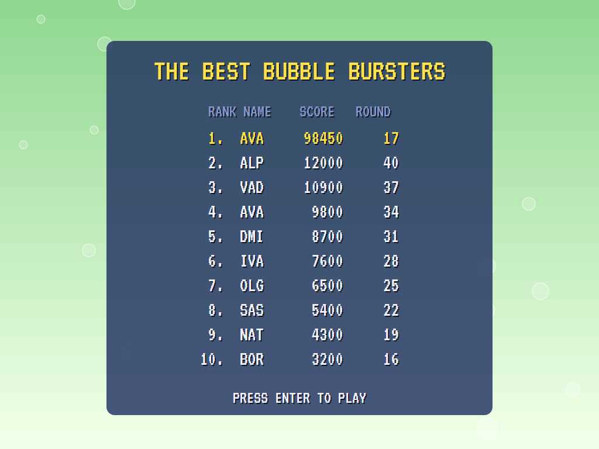

# AVA Puzzle Bobble

[](https://github.com/Harlock123/AVAPuzzleBobble/actions/workflows/build.yml)

A bubble-bursting puzzle game in the style of Taito's 1994 **Puzzle Bobble** (Bust-a-Move), built with .NET 10 and
Avalonia UI. Aim the launcher and fire bubbles into the pile. Three of a colour together burst, and anything left
hanging falls. The ceiling comes down every few shots: clear the round before the bubbles reach the line.

## Features

- **Thirty rounds** built from seeds, mirrored left to right the way the cabinet's designs were: four to seven
  rows, in three colours at first and up to six later.
- **The honeycomb:** eight bubbles across, seven on the rows set in. A shot sticks where it touches the
  ceiling or another bubble, in the nearest empty place.
- **Bank shots** off the side walls.
- **Bursting and dropping:** three or more of a colour burst, 10 points each. Every bubble no longer hanging
  from the ceiling falls, and those are worth far more: 20 points doubled for each one, up to 1,024 times.
- **The launcher** only holds colours still on the board, and shows the next bubble beside it. Wait too long
  and it says hurry, then fires on its own.
- **The ceiling** comes down a row every nine shots at first, and every six later on. Reach the line and the
  round's lost, which costs one of three lives. Clear it quickly for a time bonus.
- **The attract mode** shows the computer player at work. For each bubble it tries every angle the launcher
  can turn to, straight shots and banks, and works out where each would stick. It scores what each would
  leave: bubbles burst and dropped are best; failing that, a bubble beside its own colour, set high rather
  than low, and never one that would reach the line.

## Screenshots

| The title | Aiming | A shot |
|:---------:|:------:|:------:|
|  |  |  |

| Bursting | The ceiling down | Round clear |
|:--------:|:----------------:|:-----------:|
|  |  |  |

| Game over | The best bubble bursters |
|:---------:|:------------------------:|
|  |  |

The screenshots are made by the tests, which play the game in a real (headless) window; see
[Tests](#tests).

## Download and run

Ready-to-run builds for Windows, macOS and Linux, on both Intel/AMD and ARM, are on the
[Releases page](https://github.com/Harlock123/AVAPuzzleBobble/releases/tag/latest). **Latest build** is
rebuilt on every push to `main`. Each download is one self-contained executable: no .NET install is
needed.

| Platform | Archive |
|---|---|
| Windows | `AVAPuzzleBobble-win-x64.zip`, `AVAPuzzleBobble-win-x86.zip`, `AVAPuzzleBobble-win-arm64.zip` |
| macOS | `AVAPuzzleBobble-osx-arm64.tar.gz` (Apple silicon), `AVAPuzzleBobble-osx-x64.tar.gz` (Intel) |
| Linux | `AVAPuzzleBobble-linux-x64.tar.gz`, `AVAPuzzleBobble-linux-arm64.tar.gz`, `AVAPuzzleBobble-linux-arm.tar.gz` |

```bash
tar -xzf AVAPuzzleBobble-linux-x64.tar.gz     # or linux-arm64, linux-arm, osx-arm64, osx-x64
./AVAPuzzleBobble
```

On Windows, unzip and run `AVAPuzzleBobble.exe`. On macOS, if Gatekeeper refuses to open it, run
`xattr -d com.apple.quarantine AVAPuzzleBobble` once. Run with `--no-audio` for silence.

**Sound** comes through OpenAL Soft, built in for every platform. In a virtual machine the game
detects it and uses a larger audio buffer, so the sound doesn't break up.

**Gamepads** use SDL2, which is bundled for Windows, macOS and Intel/AMD Linux. ARM Linux builds need it
installed; without it the keyboard still works:

```bash
sudo apt install libsdl2-dev            # Debian / Ubuntu / Raspberry Pi OS
sudo pacman -S --needed sdl2-compat     # Arch / Omarchy
```

## Controls

| Action | Keyboard | Gamepad |
|---|---|---|
| Start | Enter or 1 | Start |
| Aim | Left/right arrows, or A/D | Left stick / D-pad |
| Fire | Up, Space, W, Z, X or Ctrl | A, B, X or up |
| Pause | P or Esc | Start |
| Sound on/off | M | |
| Screenshot | Ctrl+S (to your Pictures folder) | |

On the high-score table, type your initials, or use up/down and Space, then Enter.

## Tests

```bash
dotnet test AVAPuzzleBobble.slnx
```

The game runs in fixed 60 Hz steps, so it plays the same at any frame rate. Everything that changes lives in
one world that can be copied. The tests check:

- **The board:** rows of eight and seven, with neighbours one bubble apart; every round mirrored, all hanging
  from the ceiling, and more colours later.
- **Shooting:** the launcher's turning and its limits; a shot straight up sticking to the ceiling; a bank
  shot; three of a colour bursting and what hung from them falling, with the points; two of a colour just
  sticking; the launcher holding only colours still on the board; the ceiling coming down and the line lost;
  the hurry; a round cleared.
- **The game:** the time bonus and the next round; lives lost and the game over; the demonstration and high
  scores; pause; a copied world; the keys.
- **The computer player:** all thirty rounds cleared; firing straight up clears almost none from round 10 on.

`tests/AVAPuzzleBobble.Tests/PilotProbe.cs` reports how the computer player gets on, round by round, for tuning
(`BOBBLE_PROBE=1`). It clears all thirty. `BOBBLE_PROBE=lazy` fires straight up, and clears three, all early ones.

The screenshot tests draw the real screen in a headless window. To refresh the README's pictures:

```bash
BOBBLE_SHOTS=$PWD/Images dotnet test tests/AVAPuzzleBobble.Tests --filter ScreenshotTests
```

## Building

```bash
dotnet build AVAPuzzleBobble.slnx
dotnet run --project src/AVAPuzzleBobble
```

Needs the .NET 10 SDK. The sounds, music and voice are made by `tools/make_sounds.py` (standard-library
Python, with the formant voice in `tools/speech.py`): `python3 tools/make_sounds.py` rewrites
`src/AVAPuzzleBobble/Sounds`.

## Project structure

```
AVAPuzzleBobble/
├── AVAPuzzleBobble.slnx
├── src/AVAPuzzleBobble/
│   ├── Engine/
│   │   ├── GameEngine.cs        # States, rounds, lives, the time bonus, the demonstration
│   │   ├── Sim.cs               # The launcher, the shot's flight, sticking, bursting, dropping, the ceiling
│   │   ├── Board.cs             # The honeycomb, and the thirty rounds
│   │   ├── World.cs             # Everything that changes, kept together so it can be copied
│   │   ├── Pilot.cs             # The computer player (the demonstration, and the tests)
│   │   ├── HighScoreTable.cs, InitialsEntry.cs
│   │   ├── InputHandler.cs, ControllerManager.cs  # Keys and an SDL2 gamepad
│   │   └── SoundManager.cs      # Effects, music and voice through OpenAL
│   ├── Audio/                   # The OpenAL engine (from the author's AVABand)
│   ├── Views/GameCanvas*.cs     # The cabinet, the bubbles, the launcher, the sides, the title
│   └── Sounds/                  # The synthesised effects, music and voice
├── tests/AVAPuzzleBobble.Tests/ # Gameplay and screenshot tests
├── tools/make_sounds.py, tools/speech.py
└── Images/                      # Screenshots
```

## About and licence

AVA Puzzle Bobble © 2026 Lonnie Watson, under the [MIT License](LICENSE).

*Puzzle Bobble* (also *Bust-a-Move*) © 1994 Taito; the names belong to their current owner. AVA Puzzle Bobble is
an independent, unofficial game in its style. Its rounds, graphics, sounds and code are its own; nothing is taken
from the original game's program, graphics or sound. It is not affiliated with or endorsed by any rights holder.
The Blue Danube (Johann Strauss II, 1866) is in the public domain, arranged here from scratch.
